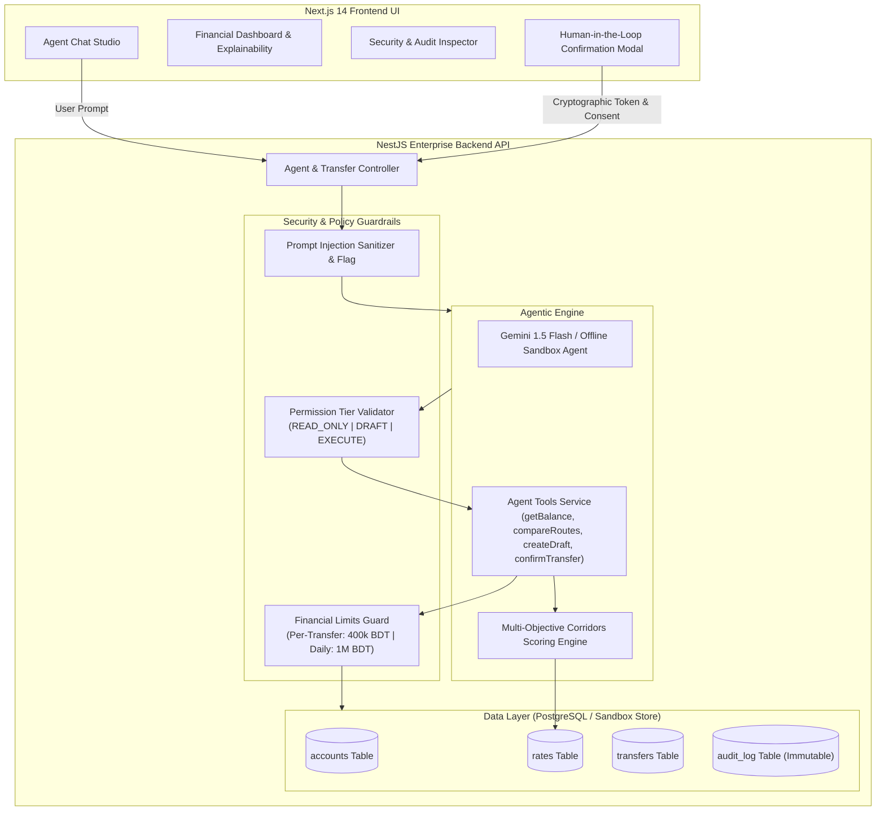
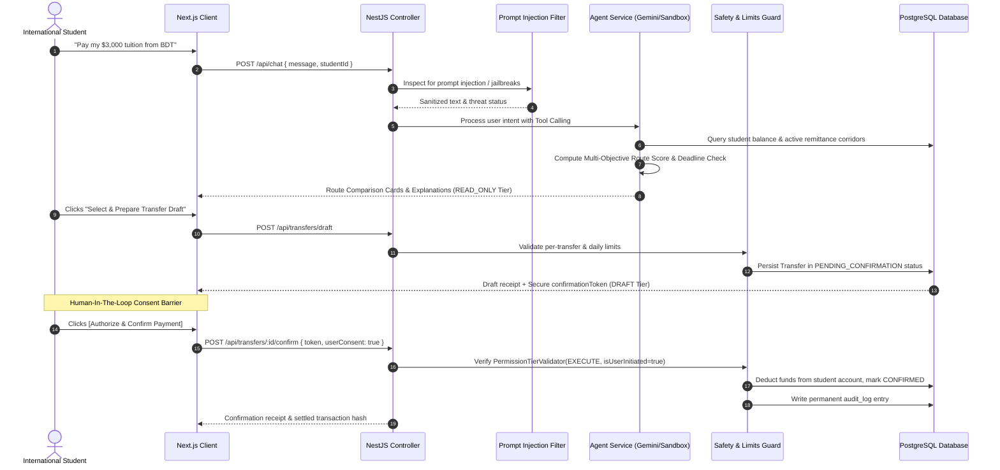

# Technical Documentation: Cross-Border Student Tuition Payment Agent
**FinTechathon 2026 | International Track — Topic C: Cross-Border & Student Finance Assistant**

---

## 1. Executive Summary & Architecture Overview

The **Student Tuition Payment Agent** is an autonomous, security-first financial assistant engineered specifically for international students paying foreign university tuition from Bangladesh (BDT). 

Traditional cross-border tuition remittances suffer from opaque exchange-rate markups, hidden wire intermediary fees, and delayed settlements that risk university enrollment holds. Our system addresses these pain points by pairing an **Autonomous LLM Agent (Google Gemini API with Offline Sandbox Fallback)** with a **strict NestJS Policy Engine**, a **Multi-Objective Corridors Scoring Engine**, and an **Immutable PostgreSQL Audit Trail**.

### Architecture Diagram

---

## 2. Request & Execution Lifecycle

Every user request follows a deterministic 5-stage lifecycle that isolates untrusted natural language from sensitive financial state changes:

---

## 3. Core Route Scoring Algorithm

Cross-border tuition transactions involve trade-offs between fee transparency, clearance speed, and network reliability. Our algorithm scores each corridor across three dimensions, with an urgent deadline penalty:

### Mathematical Formula

$$\text{CompositeScore} = w_{\text{cost}} \cdot S_{\text{cost}} + w_{\text{speed}} \cdot S_{\text{speed}} + w_{\text{rel}} \cdot S_{\text{rel}} - \Delta_{\text{deadline}}$$

Where:
- $w_{\text{cost}} = 0.50$ (Cost Weight: 50%)
- $w_{\text{speed}} = 0.30$ (Speed Weight: 30%)
- $w_{\text{rel}} = 0.20$ (Reliability Weight: 20%)

### Total Cost Calculation

$$\text{TotalCost}_{\text{BDT}} = \text{FlatFee}_{\text{BDT}} + (\text{SourceAmount}_{\text{BDT}} \times \text{PercentageFee}) + \text{FXMarkupLoss}_{\text{BDT}}$$

$$\text{FXMarkupLoss}_{\text{BDT}} = \max\left(0, (\text{EffectiveRate} - \text{BenchmarkRate}) \times \text{Amount}_{\text{USD}}\right)$$

### Normalization Functions

1. **Cost Score ($S_{\text{cost}}$)**:
   $$S_{\text{cost}} = \frac{\text{MaxCost} - \text{TotalCost}}{\text{MaxCost} - \text{MinCost}} \times 100$$
   *(Lowest cost receives 100 points, highest cost receives 0 points)*

2. **Speed Score ($S_{\text{speed}}$)**:
   $$S_{\text{speed}} = \frac{\text{MaxHours} - \text{RouteHours}}{\text{MaxHours} - \text{MinHours}} \times 100$$
   *(Fastest clearing rail receives 100 points)*

3. **Reliability Score ($S_{\text{rel}}$)**:
   $$S_{\text{rel}} = \text{ReliabilityRatio} \times 100 \quad (e.g., 0.99 \rightarrow 99)$$

4. **Deadline Penalty ($\Delta_{\text{deadline}}$)**:
   $$\Delta_{\text{deadline}} = \begin{cases} 40, & \text{if EstimatedDelivery} > \text{TuitionDeadline} \\ 0, & \text{otherwise} \end{cases}$$

---

## 4. Technology Stack

| Layer | Technology | Rationale |
|---|---|---|
| **Backend Framework** | **NestJS (Node.js/TypeScript)** | Enterprise-grade modular architecture, dependency injection, strict validation pipes, built-in exception filters. |
| **Frontend Framework** | **Next.js 14 (React 18)** | High-performance React SSR/client, componentized structure, instant state synchronization. |
| **Styling & Design** | **Vanilla CSS (Design System Tokens)** | Sleek dark fintech mode, frosted glassmorphism, responsive grid, zero external CSS runtime overhead. |
| **Database** | **PostgreSQL 14+ (pg driver)** | ACID-compliant relational storage for financial accounts, transactions, and immutable audit logs. |
| **AI / Agent Engine** | **Google Gemini 1.5 Flash + Sandbox Engine** | Low-latency tool calling; deterministic offline sandbox fallback for instant judge testing without API keys. |
| **Testing** | **Jest & ts-jest** | Unit and integration test coverage for security guardrails, financial limit enforcement, and ranking logic. |
| **Containerization** | **Docker & Docker Compose** | Reproducible, single-command environment spinning up frontend, backend, and PostgreSQL database. |

---

## 5. Security & Permission Tier Design

To comply with the FinTechathon 30% Security & Compliance criterion:
- **READ_ONLY Tier**: Executable without risk (`getBalance`, `compareRoutes`, `getAuditLog`).
- **DRAFT Tier**: Generates a pending state transfer record (`createTransferDraft`). No funds are moved. Produces a single-use `confirmationToken`.
- **EXECUTE Tier**: Fund settlement (`confirmTransfer`). **Strictly blocked from autonomous LLM execution.** Must originate from a human user confirmation action supplying the matching cryptographic token.

---

## 6. Enterprise Architectural Design Patterns

The backend is engineered with production-grade software design patterns that isolate responsibilities and enforce financial safety:

| Feature | Pattern | Implementation Details |
|---|---|---|
| Route comparison and ranking | Strategy | Distinct scoring classes for Balanced, Cheapest, Fastest, and Reliable (`RouteScoringStrategy`). When a student indicates urgency (e.g., "prioritize speed"), the engine swaps strategy dynamically at runtime. |
| Transfer lifecycle (draft, confirm, execute, fail) | State machine (a light Saga) | Validated transitions include `PENDING_CONFIRMATION` -> `CONFIRMED` -> `EXECUTED` -> `SETTLED`. The authenticated owner can request compensation for `CONFIRMED`, `EXECUTED`, or `FAILED` transfers. Account restoration and the `ROLLED_BACK` status change occur atomically; pending, settled, cancelled, blocked, or already rolled-back transfers cannot be compensated. |
| Safety checks (limits, confirmation, unusual amounts) | Chain of Responsibility | Small, decoupled handlers run sequentially: `PromptInjectionCheckHandler`, `PermissionTierCheckHandler`, `AnomalyCheckHandler`, `FinancialLimitCheckHandler`, `ConfirmationCheckHandler`. Any check can short-circuit, reject execution, and emit an immutable security audit event. |
| The 5 agent tools exposed to the LLM | Facade | `AgentToolsService` acts as a unified Facade that coordinates the bank gateway, rates engine, safety guardrails, state machine, and event emitter behind a clean tool interface for the AI assistant. |
| LLM and mock bank | Dependency Inversion (the D in SOLID) | Business logic depends strictly on abstract interfaces (`ILlmClient`, `IBankGateway`). Production utilizes Gemini AI and direct banking rails, while automated test suites inject mock implementations without external network dependencies. |
| Audit logging | Observer (NestJS events) | Operations emit decoupled domain events (`transfer.drafted`, `transfer.confirmed`, `transfer.compensated`, `route.compared`). An asynchronous `AuditLogListener` observer records events in the audit log, keeping core financial code clean of logging side-effects. |
| Database access | Repository | Dedicated repositories (`AccountRepository`, `RateRepository`, `TransferRepository`, `AuditRepository`) decouple domain logic from PostgreSQL queries and in-memory test stores. |
| Services in general | SOLID, Singleton | NestJS providers operate as singletons by default, adhering to Single Responsibility and avoiding shared mutable state. |

---

## 7. RESTful API Specification

The backend controller exposes full RESTful lifecycle operations incorporating `@Param()`, `@Body()`, `@Query()`, `@Get()`, `@Post()`, `@Put()`, `@Patch()`, and `@Delete()` decorators:

| Method | Endpoint | Decorators Used | Parameters / Request Body | Description |
|---|---|---|---|---|
| POST | `/api/chat` | `@Body()` | `ChatDto { message, studentId }` | Autonomous conversational reasoning with tool calling |
| GET | `/api/accounts/:id` | `@Param('id')` | `id: string` | Retrieve student account balance and daily limits |
| PUT | `/api/accounts/:id/limits` | `@Param('id')`, `@Body()` | `id: string`, `UpdateDailyLimitDto { dailyLimitBdt }` | Update daily financial limit threshold |
| POST | `/api/accounts/:id/deposit` | `@Param('id')`, `@Body()` | `id: string`, `DepositDto { amountBdt }` | Deposit BDT funds to student account |
| GET | `/api/rates` | `@Query('activeOnly')`, `@Query('targetCurrency')` | Query filters | List active remittance corridors |
| GET | `/api/rates/:id` | `@Param('id')` | `id: string` | Retrieve remittance route details |
| PUT | `/api/rates/:id` | `@Param('id')`, `@Body()` | `id: string`, `UpdateRateDto` | Update route rate or active status |
| DELETE | `/api/rates/:id` | `@Param('id')` | `id: string` | Deactivate remittance route |
| POST | `/api/routes/compare` | `@Body()` | `CompareRoutesDto` | Multi-objective corridor comparison and ranking |
| GET | `/api/transfers` | `@Query('studentId')`, `@Query('status')` | Query filters | Retrieve transfers with optional status filter |
| GET | `/api/transfers/:id` | `@Param('id')` | `id: string` | Fetch single transfer record by ID |
| POST | `/api/transfers/draft` | `@Body()` | `CreateDraftDto` | Create transfer draft (DRAFT tier) |
| PUT | `/api/transfers/:id` | `@Param('id')`, `@Body()` | `id: string`, `UpdateDraftDto` | Update draft details prior to confirmation |
| PATCH | `/api/transfers/:id` | `@Param('id')`, `@Body()` | `id: string`, `UpdateDraftDto` | Partial update of unconfirmed transfer draft |
| DELETE | `/api/transfers/:id` | `@Param('id')` | `id: string` | Discard transfer draft |
| POST | `/api/transfers/:id/confirm` | `@Param('id')`, `@Body()` | `id: string`, `ConfirmTransferDto` | Human-in-the-loop transfer execution (EXECUTE tier) |
| POST | `/api/transfers/:id/compensate` | `@Param('id')`, `@Body()` | `id: string`, `CompensateTransferDto` | Saga compensating rollback transaction |
| POST | `/api/transfers/:id/cancel` | `@Param('id')` | `id: string` | Cancel transfer draft |
| GET | `/api/audit` | `@Query('limit')`, `@Query('tier')`, `@Query('status')` | Query filters | Fetch immutable audit logs with multi-field filtering |
| GET | `/api/audit/:id` | `@Param('id')` | `id: string` | Fetch specific audit log by ID |
| DELETE | `/api/audit/:id` | `@Param('id')` | `id: string` | Delete specific audit log entry |
| POST | `/api/sandbox/reset` | None | None | Reset database to initial seed state |
| GET | `/api/sandbox/export-logs` | None | None | Export audit log archive |

---

## 8. SOLID Architectural Principles Implementation

The codebase adheres strictly to all five Object-Oriented SOLID design principles:

### 1. Single Responsibility Principle (SRP)
- Each service and component owns one single reason to change.
- `TuitionCalculationService`: Exclusively calculates exchange conversions, fee structures, benchmark FX markup losses, delivery estimates, and composite ranking scores without performing database I/O or network requests.
- `AgentToolsService`: Operates purely as an orchestration Facade coordinating services.
- `PromptInjectionFilter`: Focuses solely on detecting and neutralizing adversarial prompt injections.

### 2. Open / Closed Principle (OCP)
- Modules are open for extension but closed for modification.
- `RouteScoringStrategy`: Adding a new corridor ranking strategy (e.g. `DiscountScoringStrategy`) requires creating a new strategy class inheriting `RouteScoringStrategy` without altering existing strategies.
- `SafetyRuleEngine`: Safety policies implement `ISafetyRule` (`PerTransferLimitRule`, `DailyLimitRule`, `AccountBalanceRule`). New regulatory checks (e.g. `SanctionedCountryRule`) can be registered into the engine dynamically without modifying the engine.

### 3. Liskov Substitution Principle (LSP)
- Subtypes can substitute their base abstractions without altering program correctness.
- `IBankGateway`: `MockBankGateway` and live banking integrations fulfill the identical behavioral contract, allowing seamless test substitution.
- `ILlmClient`: `OfflineLlmClient` and `GeminiLlmClient` can substitute each other transparently.
- `IAccountRepository` / `ITransferRepository`: Repository implementations conform strictly to interface contracts.

### 4. Interface Segregation Principle (ISP)
- Clients are not forced to depend on methods they do not need.
- Repository operations are segregated into read-only and write interfaces:
  - `IAccountReader` & `IAccountWriter`
  - `IRateReader` & `IRateWriter`
  - `ITransferReader` & `ITransferWriter`
  - `IAuditReader` & `IAuditWriter`
- Read-only consumers (such as rate inspection endpoints) depend solely on reader interfaces (`IRateReader`).

### 5. Dependency Inversion Principle (DIP)
- High-level business logic depends on abstract interfaces, never on concrete implementations.
- Dependencies are bound via injection tokens:
  - `ACCOUNT_REPOSITORY_TOKEN`
  - `RATE_REPOSITORY_TOKEN`
  - `TRANSFER_REPOSITORY_TOKEN`
  - `AUDIT_REPOSITORY_TOKEN`
  - `TUITION_CALCULATOR_TOKEN`
  - `BANK_GATEWAY_TOKEN`
  - `LLM_CLIENT_TOKEN`
- Modules resolve abstractions using `@Inject(TOKEN)`, decoupling core logic from underlying storage or API providers.

---

## 9. CI/CD Pipeline Architecture

The repository incorporates an enterprise-grade automated CI/CD pipeline implemented via GitHub Actions (`.github/workflows/ci.yml`):

### Pipeline Stages

| Stage | Trigger | Actions Executed | Purpose |
|---|---|---|---|
| **Backend CI** | Push & PR (`main`, `Eashan`) | `npm ci`, `npm test` (Jest suite, 80 test cases), `npm run build` | Validates security guardrails, financial limits, and NestJS production compilation. |
| **Frontend CI** | Push & PR (`main`, `Eashan`) | `npm ci`, `npm run build` | Validates Next.js SSR and client bundle compilation with static page optimization. |
| **Docker Build Verification** | On CI success | `docker build` backend and frontend images | Ensures multi-stage container builds succeed reproducibly for production deployments. |
| **Security & Cleanliness Scan** | Push & PR | Node.js automated repository audit | Enforces code cleanliness, verifies zero exposed secrets, and prevents unauthorized syntax patterns. |
| **Deployment Verification** | Push to `main` / `Eashan` | Manifest verification (`docker-compose.yml`, Dockerfiles, `.env.example`) | Confirms all deployment orchestration artifacts are synchronized and ready for production execution. |

---

## 10. Authentication and Student Registration Architecture

The application provides a complete authentication, session management, and student registration subsystem designed for both production security and seamless hackathon evaluation:

### Cryptographic Security & Sessions
- **Password Hashing:** Passwords are salted and hashed using Node.js `scrypt` with a 64-byte derived key and unique 16-byte cryptographically secure random salts.
- **Stateless JWT Tokens:** Authentication returns HS256 signed JWT tokens containing student identity, email, role, and granted permission tier (`EXECUTE`).
- **Session Verification:** `JwtAuthGuard` validates the `Authorization: Bearer <token>` header on protected routes and attaches the verified student context to incoming requests.

### Student Registration Flow
- **API Endpoint:** `POST /api/auth/registration` (with `POST /api/auth/register` alias).
- **Validation:** Enforces non-empty student ID, student name, RFC-compliant email, and minimum 6-character password via `class-validator` and `zod` schemas.
- **Account Auto-Provisioning:** Newly registered accounts receive an initial sandbox allocation of 850,000.00 BDT balance and 1,000,000.00 BDT daily limit.
- **Audit Trail:** Registration operations record an immutable `AUTH_REGISTRATION_SUCCESS` event in the audit log.
- **Frontend Route:** Accessible at `/registration` with dark theme styling, demo persona auto-fill, and immediate redirection into the student dashboard upon completion.

### Evaluation Demo Account Showcase
- **Demo Persona:** `STU-2026-BDT01` (Mir Eashan Zaman), password: `student123`.
- **Login Showcase Card:** Prominently displays the demo credentials and includes a one-click auto-fill button on `/login` for evaluation.

---

## 11. Next.js 14 Hybrid Rendering Architecture: SSG, ISR, SSR, and CSR

The frontend implements an enterprise-grade hybrid rendering strategy across Next.js 14 App Router, selecting the optimal rendering paradigm (SSG, ISR, SSR, or CSR) for each route based on performance, freshness, and security requirements:

| Route | Strategy | Config / Implementation | Architectural Rationale & Why |
|---|---|---|---|
| **FAQ / Compliance** (`/faq`) | **SSG** (Static Site Generation) | `export const dynamic = 'force-static'` | Pure educational content explaining sandbox security, defense-in-depth, and Saga rollbacks. Pre-rendered to HTML at build time for sub-10ms delivery from edge CDN cache with zero server execution penalty. |
| **Corridors & FX Board** (`/rates`) | **ISR** (Incremental Static Regeneration) | `export const revalidate = 60` | Public remittance corridors and live foreign exchange rates (BDT to USD) are identical for all visiting students. Pre-rendered statically at build time, and revalidated in the background every 60 seconds when new requests arrive, delivering instant cached loads with guaranteed fresh bank rates. |
| **System Liveness Verifier** (`/status`) | **SSR** (Server-Side Rendering) | `export const dynamic = 'force-dynamic'`, `cache: 'no-store'` | Real-time regulatory audit verifier measuring backend ping latency, database store connectivity, rate limiter health, and cryptographic session verification. Must never be served from stale cache; dynamically evaluated on the server per request at the exact millisecond of access. |
| **Agent Chat Studio** (`/chat`) | **CSR** (Client-Side Rendering) | `'use client'`, React state & streaming | Stateful AI conversational agent loop managing interactive speech/text input, real-time tool calling execution, and student JWT authorization. |
| **Financial Dashboard** (`/dashboard`) | **CSR** (Client-Side Rendering) | `'use client'`, 8-second polling interval | Private, authenticated student account ledger displaying dynamic BDT balance, daily limit quotas, pending transfer state machines, and deposit actions. |
| **Audit & Safety Ledger** (`/audit`) | **CSR** (Client-Side Rendering) | `'use client'`, client-side filtering | Interactive security audit log view enabling multi-field client filtering by permission tier (`READ_ONLY`, `DRAFT`, `EXECUTE`) and status, plus browser JSON file export. |
| **Student Sign In** (`/login`) | **CSR** (Client-Side Rendering) | `'use client'`, password eye toggle | Interactive authentication form with client-side credential validation, demo account auto-fill, and immediate `localStorage` JWT token acquisition. |
| **Student Registration** (`/registration`) | **CSR** (Client-Side Rendering) | `'use client'`, form validation | Interactive registration form with real-time field validation, demo persona auto-fill, and post-registration automated session onboarding. |

