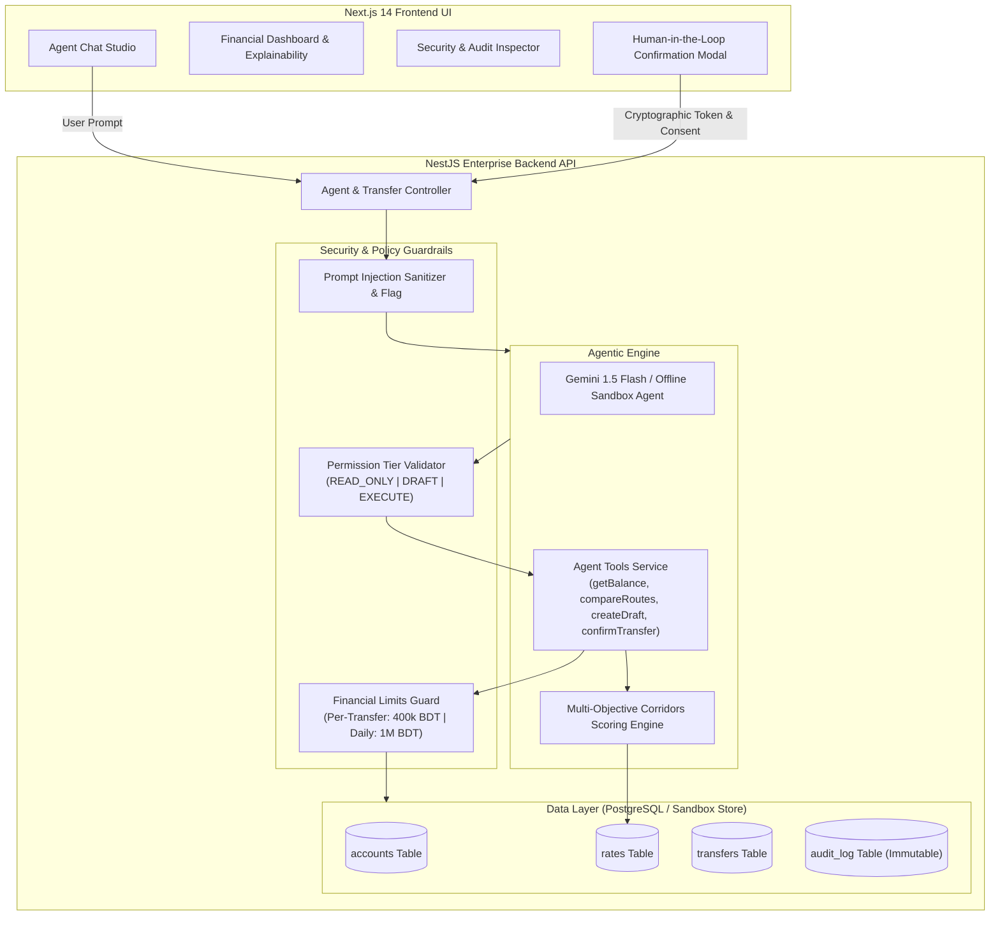
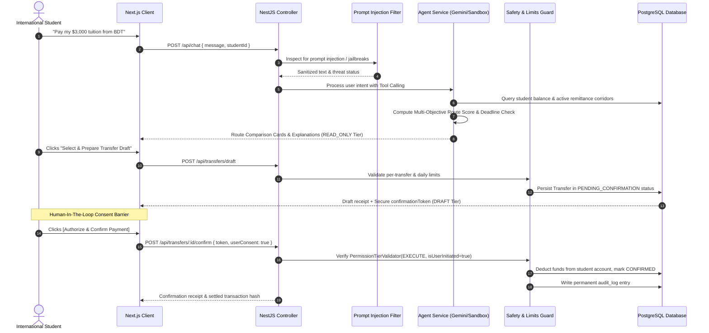

# Technical Documentation: Cross-Border Student Tuition Payment Agent
**FinTechathon 2026 | International Track — Topic C: Cross-Border & Student Finance Assistant**

---

## 1. Executive Summary & Architecture Overview

The **Student Tuition Payment Agent** is an autonomous, security-first financial assistant engineered specifically for international students paying foreign university tuition from Bangladesh (BDT). 

Traditional cross-border tuition remittances suffer from opaque exchange-rate markups, hidden wire intermediary fees, and delayed settlements that risk university enrollment holds. Our system addresses these pain points by pairing an **Autonomous LLM Agent (Google Gemini API with Offline Sandbox Fallback)** with a **strict NestJS Policy Engine**, a **Multi-Objective Corridors Scoring Engine**, and an **Immutable PostgreSQL Audit Trail**.

### Architecture Diagram

---

## 2. Request & Execution Lifecycle

Every user request follows a deterministic 5-stage lifecycle that isolates untrusted natural language from sensitive financial state changes:

---

## 3. Core Route Scoring Algorithm

Cross-border tuition transactions involve trade-offs between fee transparency, clearance speed, and network reliability. Our algorithm scores each corridor across three dimensions, with an urgent deadline penalty:

### Mathematical Formula

$$\text{CompositeScore} = w_{\text{cost}} \cdot S_{\text{cost}} + w_{\text{speed}} \cdot S_{\text{speed}} + w_{\text{rel}} \cdot S_{\text{rel}} - \Delta_{\text{deadline}}$$

Where:
- $w_{\text{cost}} = 0.50$ (Cost Weight: 50%)
- $w_{\text{speed}} = 0.30$ (Speed Weight: 30%)
- $w_{\text{rel}} = 0.20$ (Reliability Weight: 20%)

### Total Cost Calculation

$$\text{TotalCost}_{\text{BDT}} = \text{FlatFee}_{\text{BDT}} + (\text{SourceAmount}_{\text{BDT}} \times \text{PercentageFee}) + \text{FXMarkupLoss}_{\text{BDT}}$$

$$\text{FXMarkupLoss}_{\text{BDT}} = \max\left(0, (\text{EffectiveRate} - \text{BenchmarkRate}) \times \text{Amount}_{\text{USD}}\right)$$

### Normalization Functions

1. **Cost Score ($S_{\text{cost}}$)**:
   $$S_{\text{cost}} = \frac{\text{MaxCost} - \text{TotalCost}}{\text{MaxCost} - \text{MinCost}} \times 100$$
   *(Lowest cost receives 100 points, highest cost receives 0 points)*

2. **Speed Score ($S_{\text{speed}}$)**:
   $$S_{\text{speed}} = \frac{\text{MaxHours} - \text{RouteHours}}{\text{MaxHours} - \text{MinHours}} \times 100$$
   *(Fastest clearing rail receives 100 points)*

3. **Reliability Score ($S_{\text{rel}}$)**:
   $$S_{\text{rel}} = \text{ReliabilityRatio} \times 100 \quad (e.g., 0.99 \rightarrow 99)$$

4. **Deadline Penalty ($\Delta_{\text{deadline}}$)**:
   $$\Delta_{\text{deadline}} = \begin{cases} 40, & \text{if EstimatedDelivery} > \text{TuitionDeadline} \\ 0, & \text{otherwise} \end{cases}$$

---

## 4. Technology Stack

| Layer | Technology | Rationale |
|---|---|---|
| **Backend Framework** | **NestJS (Node.js/TypeScript)** | Enterprise-grade modular architecture, dependency injection, strict validation pipes, built-in exception filters. |
| **Frontend Framework** | **Next.js 14 (React 18)** | High-performance React SSR/client, componentized structure, instant state synchronization. |
| **Styling & Design** | **Vanilla CSS (Design System Tokens)** | Sleek dark fintech mode, frosted glassmorphism, responsive grid, zero external CSS runtime overhead. |
| **Database** | **PostgreSQL 14+ (pg driver)** | ACID-compliant relational storage for financial accounts, transactions, and immutable audit logs. |
| **AI / Agent Engine** | **Google Gemini 1.5 Flash + Sandbox Engine** | Low-latency tool calling; deterministic offline sandbox fallback for instant judge testing without API keys. |
| **Testing** | **Jest & ts-jest** | Unit and integration test coverage for security guardrails, financial limit enforcement, and ranking logic. |
| **Containerization** | **Docker & Docker Compose** | Reproducible, single-command environment spinning up frontend, backend, and PostgreSQL database. |

---

## 5. Security & Permission Tier Design

To comply with the FinTechathon 30% Security & Compliance criterion:
- **READ_ONLY Tier**: Executable without risk (`getBalance`, `compareRoutes`, `getAuditLog`).
- **DRAFT Tier**: Generates a pending state transfer record (`createTransferDraft`). No funds are moved. Produces a single-use `confirmationToken`.
- **EXECUTE Tier**: Fund settlement (`confirmTransfer`). **Strictly blocked from autonomous LLM execution.** Must originate from a human user confirmation action supplying the matching cryptographic token.
